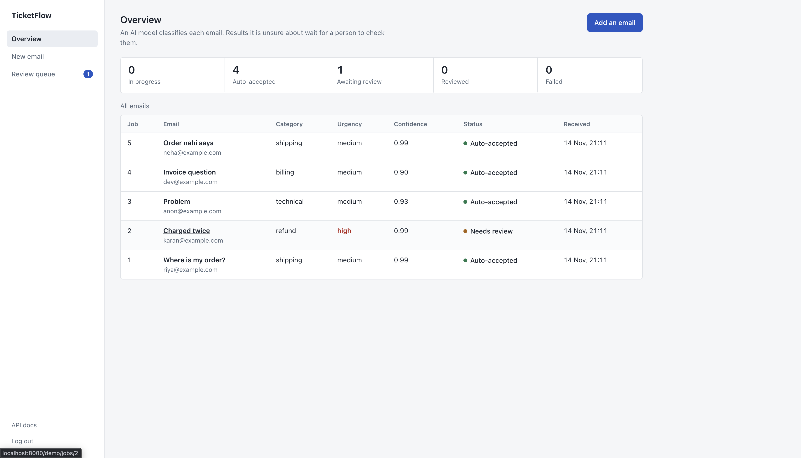
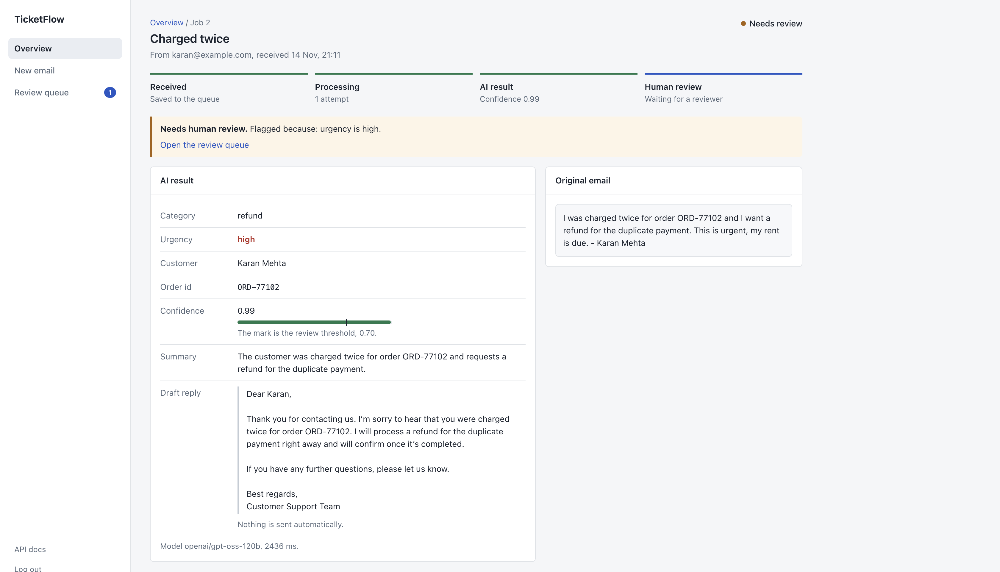
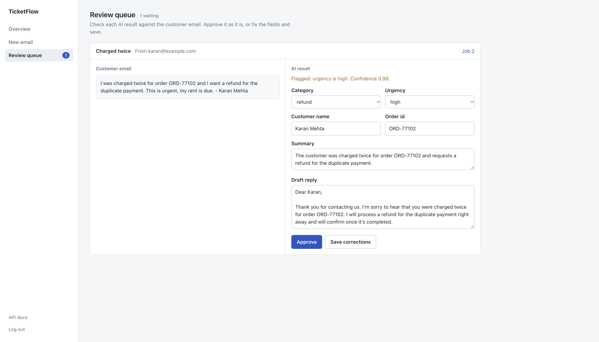
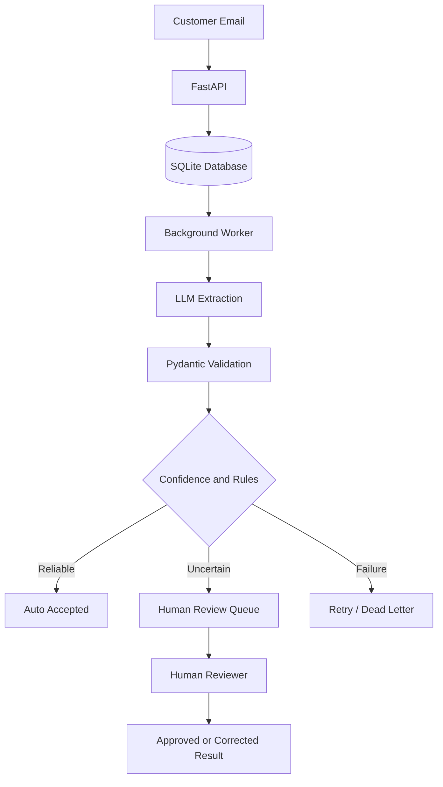
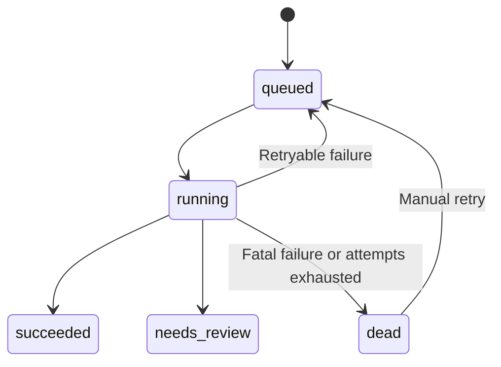

# TicketFlow

**An AI-powered customer support email processing system built with FastAPI, Python, SQLite and background workers.**

TicketFlow converts unstructured customer support emails into structured, validated information using an LLM. It processes emails asynchronously, automatically handles reliable results, and sends uncertain cases to a human review queue.

## Screenshots

### Dashboard


### Job Details


### Human Review Queue


## Features

- **Email processing:** Extracts customer name, order ID, category, urgency, summary and suggested reply from customer emails.
- **Background processing:** Separates API requests from email processing using a dedicated worker.
- **Structured output:** Uses Pydantic validation to validate LLM responses.
- **Human review:** Routes uncertain or flagged results to a review queue.
- **Retry mechanism:** Retries temporary failures using exponential backoff and jitter.
- **Idempotency:** Prevents duplicate jobs when the same idempotency key is submitted again.
- **Job management:** Tracks queued, running, succeeded, needs-review and dead-letter states.
- **Dashboard:** Provides an interface to monitor jobs, inspect results and review uncertain cases.
- **API security:** Uses API-key authentication and rate limiting.
- **Evaluation:** Includes a synthetic dataset, keyword baseline and evaluation pipeline.
- **Docker support:** Runs the API and worker as separate containers.

## Architecture

A customer email enters through the API or web interface. The API stores the email and creates a job. A separate worker picks up the job, calls the LLM, validates the output and updates the job status.



### Job lifecycle



## Reliability and Backend Design

TicketFlow focuses on reliable processing rather than simply calling an LLM.

| Problem | Implementation |
|---|---|
| Duplicate email submissions | Idempotency keys |
| Multiple workers claiming the same job | Atomic job claiming using SQLite transactions |
| Worker failure during processing | Expiring job locks |
| Temporary provider errors | Exponential backoff with jitter |
| Repeated processing failures | Dead-letter state after configured attempts |
| Invalid LLM output | Pydantic schema validation |
| Uncertain predictions | Human review queue |
| API abuse | API-key authentication and rate limiting |

## Evaluation

The evaluation used 30 held-out synthetic customer-support emails. A keyword-based baseline was also implemented for comparison.

| Metric | LLM | Keyword Baseline |
|---|---:|---:|
| Category accuracy | 30/30 | 21/30 |
| Urgency accuracy | 28/30 | Not applicable |
| Customer name extraction | 30/30 | Not applicable |
| Order ID extraction | 30/30 | Not applicable |
| Hallucinated order IDs or names | 0/30 | Not applicable |

- 23 of 30 results were auto-accepted.
- Three of four pre-registered evaluation criteria passed.
- Two urgency classifications were incorrect.
- Full methodology and limitations are documented in [`eval/RESULTS.md`](eval/RESULTS.md).

**Evaluation limitations:** The dataset is small and synthetic. Labels were drafted by an LLM and reviewed by one person. The prompt was tuned using 10 development examples. These results should not be treated as evidence of production accuracy.

## Load Testing

Load testing was performed locally using Docker Compose on a MacBook Air M1.

**Test configuration:**
- API instances: 1
- Worker instances: 1
- LLM: Fake LLM
- Requests per run: 200
- Concurrency: 20
- Total runs: 3

### Results

| Metric | Run 1 | Run 2 | Run 3 |
|---|---:|---:|---:|
| Accepted requests | 200 | 200 | 200 |
| Enqueue throughput | 86.5 req/s | 108.2 req/s | 86.2 req/s |
| Median latency | 34 ms | 36.9 ms | 40.3 ms |
| P95 latency | 1085.4 ms | 679.8 ms | 1200.3 ms |
| End-to-end throughput | 59.4 jobs/s | 72.7 jobs/s | 58.9 jobs/s |
| Dead jobs | 0 | 0 | 0 |

Across all three runs, 600 jobs were accepted and successfully processed.

**Note:** These tests measure the API, queue, database and worker pipeline using a fake LLM. They do not measure real LLM inference performance or establish production-scale capacity.

Raw results are available in:
- [`Run 1`](docs/load_test_run1.json)
- [`Run 2`](docs/load_test_run2.json)
- [`Run 3`](docs/load_test_run3.json)

## Tech Stack

| Category | Technologies |
|---|---|
| Language | Python |
| Backend | FastAPI |
| Database | SQLite |
| Validation | Pydantic |
| LLM Integration | Groq API, OpenAI-compatible client |
| Testing | Pytest, HTTPX |
| Frontend | HTML, CSS, JavaScript, Jinja2 |
| Containerization | Docker, Docker Compose |
| CI | GitHub Actions |

## Getting Started

### Prerequisites

- Python 3.14+
- Docker Desktop (recommended)
- Git

### 1. Clone the repository

```bash
git clone https://github.com/Mitali-A13/ticketflow.git
cd ticketflow
```

### 2. Configure environment variables

```bash
cp .env.example .env
```

Generate an API key:

```bash
python -c "import secrets; print(secrets.token_urlsafe(32))"
```

Add the generated value to `.env` as `TICKETFLOW_API_KEY`.

### 3. Run with Docker

For local testing without real LLM API calls:

```bash
FAKE_LLM=true docker compose up --build
```

Open:

```text
http://localhost:8000
```

Sign in using the API key configured in `.env`.

### 4. Run with a real LLM

Configure your Groq API key in `.env` and set:

```env
FAKE_LLM=false
```

Then run:

```bash
docker compose up --build
```

### 5. Run without Docker

Create and activate a virtual environment:

```bash
python3 -m venv .venv
source .venv/bin/activate
```

Install dependencies:

```bash
pip install -r requirements.txt
```

Run tests:

```bash
pytest -q
```

Start the API:

```bash
uvicorn app.main:app --reload
```

Start the worker in another terminal:

```bash
python -m app.worker
```

### 6. Run the load test

Start Docker Compose with the fake LLM and a higher rate limit:

```bash
FAKE_LLM=true RATE_LIMIT_PER_MIN=100000 docker compose up -d
```

Run:

```bash
python scripts/load_test.py --requests 200 --concurrency 20
```

## API Endpoints

| Endpoint | Description |
|---|---|
| `POST /emails` | Submit a customer email |
| `GET /jobs/{id}` | Retrieve job status and result |
| `GET /jobs` | List jobs, optionally filtered by status |
| `POST /jobs/{id}/retry` | Retry a dead-letter job |
| `GET /metrics` | View processing metrics |
| `GET /health` | Health check |

All endpoints except `/health` require an `X-API-Key` header.

Interactive API documentation is available at `/docs`.

## Project Structure

```text
ticketflow/
├── app/
│   ├── main.py
│   ├── worker.py
│   ├── queue.py
│   ├── db.py
│   ├── models.py
│   ├── extract.py
│   ├── auth.py
│   ├── reviews.py
│   ├── ops.py
│   ├── templates/
│   └── static/
├── eval/
│   ├── PLAN.md
│   ├── RESULTS.md
│   └── ...
├── scripts/
│   └── load_test.py
├── tests/
├── Dockerfile
├── docker-compose.yml
├── requirements.txt
└── README.md
```

## Known Limitations and Future Improvements

- SQLite supports limited concurrent writes. PostgreSQL with `SELECT ... FOR UPDATE SKIP LOCKED` is a potential next step.
- The rate limiter is in-memory and per process.
- Authentication currently uses one shared API key rather than individual user accounts.
- Provider `Retry-After` headers are not yet handled.
- Suggested replies are not automatically sent to customers.
- There is no direct Gmail or other inbox integration.
- The application has not been deployed publicly.

## Author

**Mitali Awasthi**

[GitHub](https://github.com/Mitali-A13)